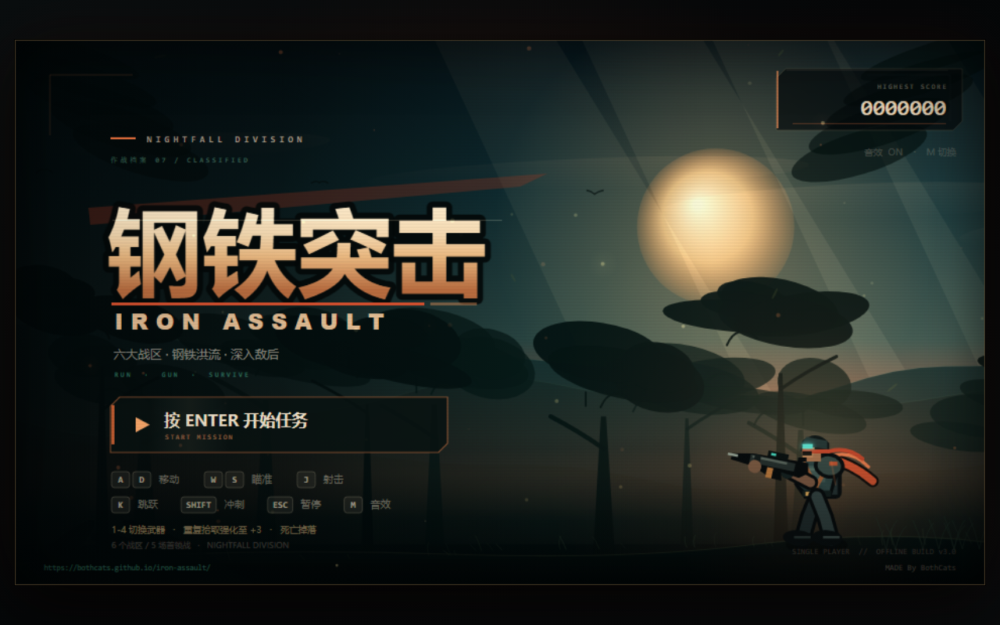
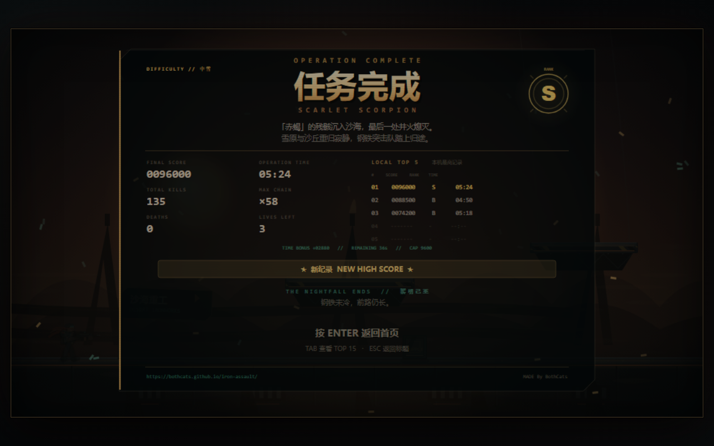

### 🎮 IRON ASSAULT / 钢铁突击

> **六大战区 · 钢铁洪流 · 深入敌后**

一款使用 **HTML5 Canvas + Web Audio API** 制作的单文件横版跑射游戏。

不用安装、不用构建、没有外部素材依赖。打开浏览器，拿起枪，直接冲进六个战区。



#### ✨ 功能亮点

- **🎯 纯手动的横版射击**：没有自动瞄准，走位、瞄准、跳跃和冲刺都由你决定。
- **🗺️ 六大战区 / 五场 Boss 战**：丛林、钢铁核心、熔炉、天穹要塞、雪原铁路、沙海重工。
- **🔫 四种武器，三阶强化**：突击步枪、速射机枪、散射炮、穿透激光。重复拾取可强化，死亡会掉落武器。
- **💀 风险与代价**：普通死亡可返回拾取武器；坠落深渊死亡则永久遗失。
- **🔥 连杀倍率**：每连续击杀一个敌人，积分倍率增加 2%；连杀超时后清零。
- **🏅 通关评级**：SSS / S / A / B / C / D。100,000 分及以上为 SSS，非常困难。
- **📊 本机 TOP5**：自动记录本机最高分和最高五条成绩。
- **🎵 全程序化音频**：所有关卡音乐、Boss 音乐和音效均由 Web Audio 实时合成，无 MP3 文件。



#### 🛠️ 技术栈

- **HTML5 / Canvas 2D**：固定 960 × 540 内部渲染，自适应窗口。
- **Vanilla JavaScript**：原生 ES6+，零框架、零依赖。
- **Web Audio API**：实时合成鼓点、贝斯、主旋律、琶音和最终通关庆祝音乐。
- **localStorage**：保存最高分、TOP5 记录和音效设置。

#### 🚀 如何运行

本项目为纯静态页面，无需构建工具。

1. 克隆仓库：

   ```bash
   git clone git@github.com:BothCats/iron-assault.git
   ```

2. 直接在浏览器打开 `index.html`。

#### 🌐 在线访问

[👉 点击这里开始游戏](https://bothcats.github.io/iron-assault/)

#### 🎮 操作

| 按键                  | 功能             |
| --------------------- | ---------------- |
| `A` / `D`             | 移动             |
| `W` / `S`             | 八向瞄准         |
| `J` / `Z`             | 射击             |
| `K` / `X` / `Space`   | 跳跃             |
| `Shift` / `L`         | 冲刺（短暂无敌） |
| `1` / `2` / `3` / `4` | 切换武器         |
| `Tab`                 | 循环切换武器     |
| `Esc` / `P`           | 暂停             |
| `M`                   | 音效开关         |
| `Enter`               | 开始 / 确认      |

> PC 键盘操作，暂不支持移动端触控。

#### 🏅 评级与时间奖励

通关时间在 300 秒以内时，每剩余 1 秒额外获得 10 分；超过 300 秒不扣分。时间奖励会计入最终分数，再按最终分数评定等级。

| 评级    |  最终分数 |
| ------- | --------: |
| **SSS** | ≥ 100,000 |
| **S**   |  ≥ 95,000 |
| **A**   |  ≥ 90,000 |
| **B**   |  ≥ 70,000 |
| **C**   |  ≥ 25,000 |
| **D**   |  < 25,000 |

#### 🎵 音乐设计

- 第 1 关「丛林前线」：保留原始战斗主题。
- 第 2 关「钢铁核心」：保留原始工业推进主题。
- 第 3 关「熔炉深渊」：保留原有熔炉主题。
- 第 4 关「天穹要塞」：空灵、冷冽的高空氛围。
- 第 5 关「雪原铁路」：慢速机械律动与雪原行进感。
- 第 6 关「沙海重工」：异域音阶与工业压迫感。
- 最终通关：播放一段短促的庆祝 Fanfare，随后安静收尾。

#### 💾 存档说明

存档保存在浏览器 `localStorage` 中：

- `ironAssault.best`：历史最高分
- `ironAssault.history`：本机 TOP5 成绩
- `ironAssault.muted`：音效开关

刷新页面、重新打开浏览器都会保留；清除站点数据、无痕模式关闭后会丢失。不跨浏览器或设备同步。

#### 💡 开发手记

> “把弹幕、Boss、雪原列车和漫长沙漠都塞进一个 HTML 文件里，是我对街机年代的一次致敬。”

希望你在某个 Boss 倒下的瞬间，能听见代码背后的那一点心跳。

---

#### 📄 License

本项目基于 [MIT License](LICENSE) 开源。

**Made with ❤️ and 💻 by BothCats**
